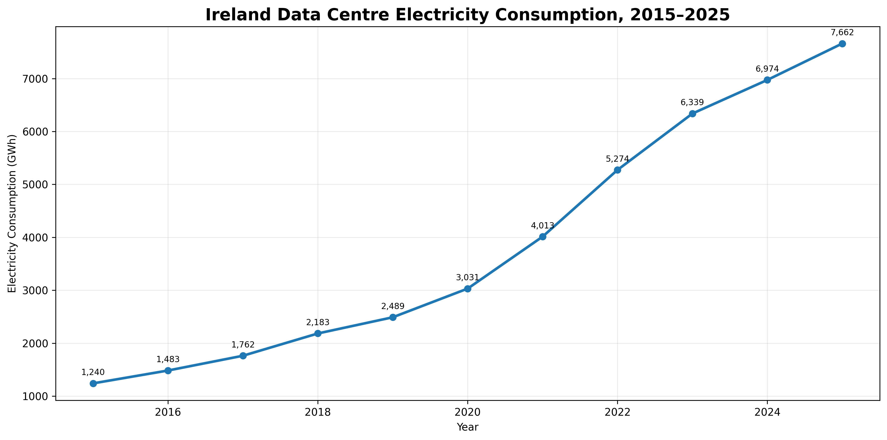
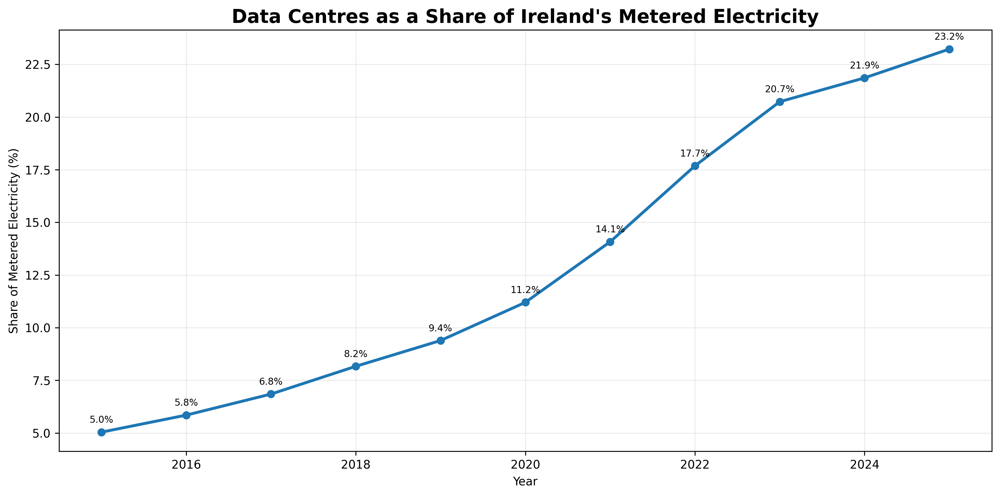
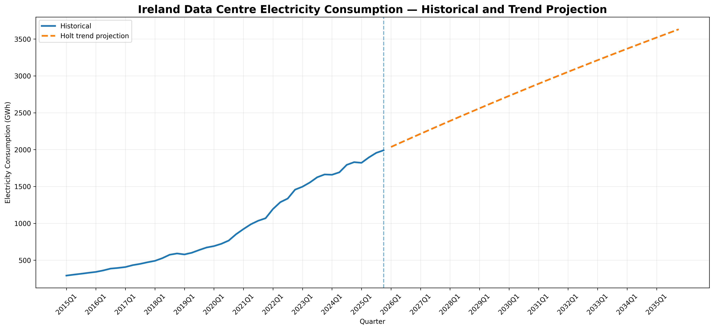
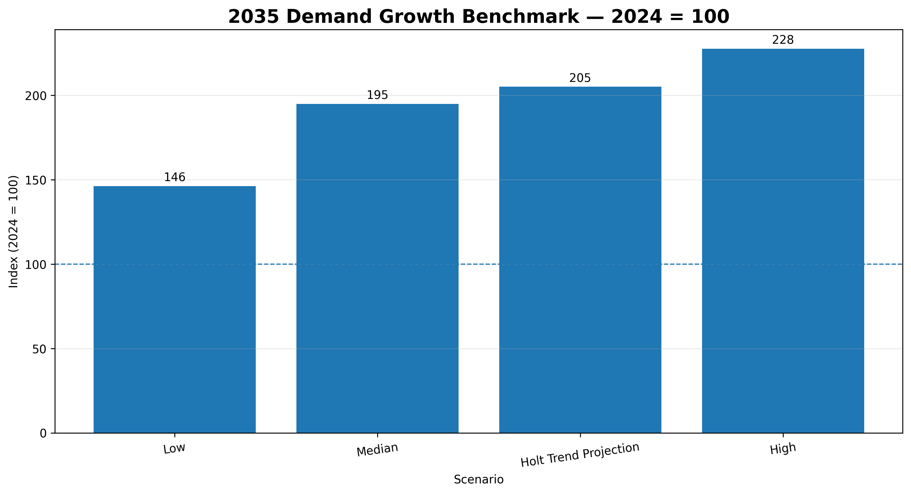

# Ireland Data Centre Energy Analytics

A reproducible Python analysis of how data-centre growth is changing Ireland's electricity demand, how that demand relates to the recent electricity-supply mix, and what continued growth could imply for the Irish grid through 2035.

> This is an independent portfolio analysis based on official public data. Forecasts and scenarios are analytical projections, not official forecasts or policy recommendations.

## Project question

**How has data-centre growth changed Ireland's electricity demand, and what could continued growth mean for the electricity system through 2035?**

## Key findings

| Finding | Result |
|---|---:|
| Data-centre electricity consumption, 2015 | 1,240 GWh |
| Data-centre electricity consumption, 2025 (sum of quarterly MEC02 values) | 7,662 GWh |
| 2015–2025 growth | 6.18× |
| 2015–2025 CAGR | ~20.0% |
| Share of metered electricity, 2015 | ~5.0% |
| Share of metered electricity, 2025 | ~23.2% |
| Share of net metered-demand growth attributable to data centres | ~76.6% |
| Best tested forecasting model | Holt damped trend |
| Rolling-origin validation RMSE | ~43 GWh |
| Rolling-origin validation MAPE | ~2.0% |
| 2030 trend projection | ~11.2 TWh/year |
| 2035 trend projection | ~14.3 TWh/year |
| Additional 2035 demand vs 2025 | ~6.6 TWh/year |
| Equivalent additional average continuous load | ~0.76 GW |

The 2035 Holt trend projection sits between EirGrid's **Median** and **High** 2035 growth scenarios when both are normalised to a 2024 index. This is a growth comparison only: EirGrid uses MVA and a broader Data Centre and New Technology Load category, while the CSO series measures metered data-centre energy consumption in GWh.

## Selected visuals

### Historical growth



### Share of metered electricity



### Forecast and historical series



### EirGrid growth benchmark



## Analysis workflow

1. Validate and reshape official CSO quarterly data-centre electricity data.
2. Aggregate quarterly consumption into annual totals and growth metrics.
3. Analyse Ireland's 2023–2025 electricity supply mix and 2025 monthly supply data.
4. Join 2025 quarterly data-centre consumption with quarterly grid-supply metrics.
5. Compare simple forecasting approaches using rolling-origin one-step-ahead validation over 2024–2025.
6. Refit the best-performing model on the full 2015–2025 history and project the statistical trend to 2035.
7. Benchmark projected growth against EirGrid's official AIRAA scenarios.
8. Translate the projection into illustrative supply, renewable-capacity and carbon-intensity sensitivities.

## Forecasting methodology

Four transparent models are compared:

- Seasonal naive
- Linear trend
- Exponential/log-linear trend
- Holt damped trend

The final version uses **rolling-origin validation** for 2024 Q1–2025 Q4. At each quarter, every model is trained only on data that would have been available before that observation. This avoids leakage and gives the models a fair one-step-ahead comparison.

The Holt damped trend produces the lowest RMSE and MAPE in this validation window and is therefore used for the long-run trend projection.

## Data-quality notes

- The quarterly MEC02 observations sum to **7,662 GWh for 2025**, while the CSO published headline reports **7,663 GWh**. The project keeps the raw quarterly values unchanged and documents the 1 GWh rounding/aggregation difference.
- Monthly 2025 electricity supply derived from ESSA02 sums to approximately **35,883.807 GWh**, compared with **35,884 GWh** in the annual ESSA04 table, a 0.193 GWh rounding difference.
- Grid supply is not identical to consumer demand. CSO notes that transmission/distribution losses and other accounting differences must be considered when comparing the two concepts.

## Repository structure

```text
Ireland Data Centre Energy Analytics/
├── README.md
├── requirements.txt
├── notebooks/
│   └── Ireland_Data_Centre_Energy_Analytics_Final.ipynb
├── data/
│   ├── raw/
│   └── processed/
├── charts/
├── src/
└── docs/
    ├── data_sources.md
    └── methodology.md
```

## Main data sources

### Central Statistics Office (CSO)

- Data Centres Metered Electricity Consumption 2025 — MEC02  
  https://www.cso.ie/en/releasesandpublications/ep/p-dcmec/datacentresmeteredelectricityconsumption2025/
- Electricity Supply by Source 2025 — ESSA02 and ESSA04  
  https://www.cso.ie/en/releasesandpublications/ep/p-ess/electricitysupplybysource2025/

### EirGrid

- All-Island Resource Adequacy Assessment 2026–2035  
  https://www.eirgrid.ie/airaa

### Sustainable Energy Authority of Ireland (SEAI)

- Energy statistics  
  https://www.seai.ie/data-and-insights/seai-statistics/
- Conversion and electricity-emission factors  
  https://www.seai.ie/data-and-insights/seai-statistics/conversion-factors

See [`docs/data_sources.md`](docs/data_sources.md) for the dataset-level source register and [`docs/methodology.md`](docs/methodology.md) for assumptions and limitations.

## Technology

- Python
- pandas
- NumPy
- Matplotlib
- scikit-learn
- statsmodels
- Google Colab

## Run locally

```bash
git clone https://github.com/danielsantos2310/Ireland-Data-Center-Energy-research.git
cd Ireland-Data-Center-Energy-research
pip install -r requirements.txt
jupyter lab
```

Open `notebooks/Ireland_Data_Centre_Energy_Analytics_Final.ipynb` and run the notebook from top to bottom.

The notebook is path-portable: it runs from the repository structure locally and can also detect the Google Drive project path when opened in Colab.

## Limitations

This analysis is intentionally transparent about its boundaries:

- The historical data-centre series is national and aggregated, not site-level.
- The grid-supply files used here provide only 2023–2025 annual history and 2025 monthly detail.
- The four 2025 quarterly joined observations are descriptive and are not sufficient for causal inference.
- Long-horizon demand projections are sensitive to planning, regulation, grid connections, customer behaviour and technology changes.
- EirGrid MVA scenarios and CSO GWh consumption data are not directly interchangeable.
- Renewable-capacity and carbon results are scenario sensitivities rather than forecasts of the future generation mix.

## Author

Daniel Santos — Data Analytics / Software Engineering portfolio project.
